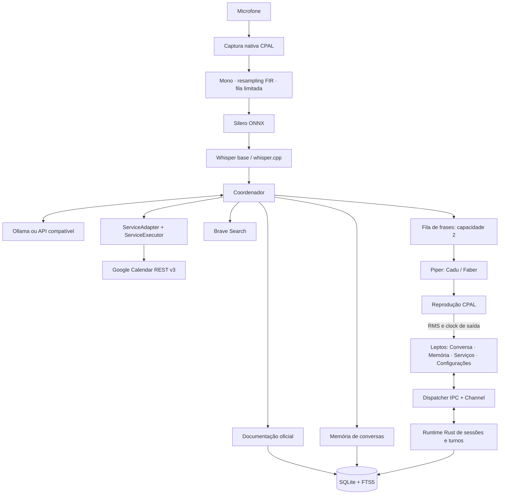

# Arquitetura implementada

Aura é um monólito desktop modular: frontend Leptos CSR/WASM, janela Tauri 2 e runtime Rust independente da WebView. O primeiro alvo é Linux/CPU e o primeiro serviço é Google Calendar. O [Coucou](https://github.com/Louis-CFM/coucou) foi usado como referência de interação desktop; seus assets não foram reutilizados.

## Fluxo



## 1. Áudio e modelos

A entrada e saída pertencem ao Rust, não à WebView. O callback de captura normaliza canais e usa envio não bloqueante a uma fila de capacidade 32. O consumidor aplica um resampler FIR por sinc janelada para mono/16 kHz. Overflow resulta em erro explícito, sem transcrição silenciosamente corrompida.

Silero recebe frames de 512 amostras. O segmentador mantém pre-roll de 250 ms, exige cerca de 200 ms de fala, encerra com aproximadamente 600 ms de silêncio e limita cada fala a 45 segundos. O VAD é aquecido antes de abrir o microfone. Durante geração e reprodução o microfone fica fechado; ao concluir a resposta, uma conversa por voz retoma a escuta.

O worker Python persistente carrega os modelos sob demanda e os mantém na sessão: `pywhispercpp` faz a ponte para whisper.cpp, ONNX Runtime executa Silero/Piper e Piper gera PCM de voz. Não há criação de um interpretador por frase e não há dependência de PyTorch.

O protocolo privado stdin/stdout é NDJSON, com PCM codificado em base64 e limites de tamanho nos dois lados. Logs nativos são redirecionados a stderr. A instalação explícita de artefatos usa catálogo fechado, revisão imutável, conferência de hash, staging e ativação atômica. Instalações incompletas não substituem uma revisão funcional.

```text
app_data/
  memory.db
  models/
    whisper-base/<revision>/ggml-base.bin
    whisper-base/current.json
    silero-vad/<revision>/silero_vad.onnx
    silero-vad/current.json
    pt_BR-cadu-medium/<revision>/...onnx + ...onnx.json + MODEL_CARD
    pt_BR-cadu-medium/current.json
    pt_BR-faber-medium/<revision>/...
```

Na saída, o Rust reamostra para a frequência do dispositivo. RMS é calculado nos valores enviados ao dispositivo e associado à previsão de playback informada pelo CPAL. O círculo recebe notificações pequenas, sem transportar PCM à WebView. Texto gerado não determina a amplitude da animação. Interrupção fecha o stream e zera o nível.

Padrões: Whisper base multilíngue, Piper Cadu/Faber, CPU e nenhuma mudança automática para serviços de áudio remotos. Kokoro continua como opção pesquisada para expansão, não como motor integrado. Comparação e fontes em [MODELOS.md](MODELOS.md).

## 2. Provedores LLM e coordenador

O adaptador de provedor suporta Ollama (`/api/chat`, NDJSON) e APIs compatíveis (`chat/completions`, SSE). O parser preserva UTF-8 fragmentado, monta argumentos parciais de ferramentas e recusa streams truncados. Há limites de tamanho para respostas e argumentos.

`provider_probe` testa de verdade uma ferramenta fictícia com nonce, seu resultado, uma resposta em português e cancelamento do stream. O resultado é ligado à configuração. Alterar configuração ou credencial invalida o teste. Ollama também fornece metadados/template usados na verificação de fingerprint. Em APIs genéricas, revisões internas do modelo que não são expostas pelo provedor não podem ser detectadas apenas pelo ID.

O coordenador vive no módulo `agent/` (`mod.rs` com o loop, `prompt.rs` com o prompt de sistema e `approvals.rs` com as confirmações). O modelo alterna texto e chamadas de ferramenta no mesmo turno. O texto de todas as rodadas é transmitido à interface e a uma única fila de frases por turno, sintetizada e reproduzida enquanto o texto continua chegando. Depois de uma ação proposta, ou no limite de rodadas, a última rodada roda sem ferramentas. Dados de ferramentas não são lidos em voz alta porque só o texto do assistente vai para o TTS.

Limites: três rodadas, seis chamadas e concorrência de até dois especialistas. Histórico antigo e resultados extensos são reduzidos por orçamento conservador de caracteres, preservando instruções, pedido recente e pares de chamada/resultado. Não há tokenizer específico para cada API; o provedor mantém seus limites finais de tokens.

Cancelamento invalida a geração e propaga para requests, worker e reprodução. Cada evento tem sessão, turno, geração e sequência. A UI aplica também uma época local para descartar callbacks de canais substituídos. Operações externas já confirmadas seguem uma vida própria: parar o áudio não significa desfazer uma criação enviada ao Google.

## 3. Serviços, conhecimento e operações

`ServiceAdapter` define identidade, ferramentas e fontes permitidas. `ServiceExecutor` executa ferramentas com contexto de sessão, banco e cancelamento. O registro é feito em código na inicialização; não há plugins externos baixados pelo usuário. O teste de extensibilidade registra e consulta outro serviço sem mudanças no coordenador ou no áudio.

Ferramentas comuns são `knowledge_search`, `memory_search`, `conversation_get` e `web_search`. Todas as integrações habilitadas e conectadas expõem suas ferramentas simultaneamente (`Integration`/`IntegrationRegistry`). O Google Calendar expõe `calendar_list`, `calendar_events`, `calendar_free_busy` e `calendar_create_event` (efeito `external_write`, exige confirmação). O modelo não recebe ferramenta de confirmação, edição ou exclusão.

A documentação oficial é obtida de uma lista de URLs do adaptador, com redirects restritos, extração de texto e preservação da cópia anterior em falhas. Uma síntese local identificada como resumo fornece contexto básico antes da primeira atualização. A pesquisa Brave complementa a documentação e retorna fontes; ela depende de chave configurada.

O prompt distingue instruções de conteúdo recuperado e instrui o modelo a não enviar informações privadas da agenda à pesquisa pública. Esta política depende do comportamento do modelo; não representa uma garantia formal contra vazamento por um modelo comprometido. Conteúdo recuperado é apresentado como texto e nunca executado como HTML ou como confirmação.

No Calendar, consultar e preparar não criam eventos. A proposta inclui agenda, título, início, fim, fuso, conflitos e expiração de dez minutos. Confirmação fica vinculada à sessão e conta. Uma alteração cancela a proposta anterior. A criação revalida permissões e disponibilidade; mudanças de conflito pedem nova confirmação.

A operação usa um UUID em formato hexadecimal aceito como ID de evento pelo Google. Em timeout, o estado passa a `unknown`; reconciliação consulta esse mesmo ID. Preparar nova tentativa, quando o evento não é encontrado, preserva o ID e exige outra confirmação. Não há retry automático cego de gravação.

OAuth usa navegador do sistema, PKCE S256, `state`, callback temporário em loopback e refresh token. Segredos ficam no Secret Service via `secret-tool` ou somente em RAM. Nenhum token é retornado ao frontend. Detalhes em [EXECUCAO.md](EXECUCAO.md).

## 4. Memória e frontend

SQLite usa WAL, integridade referencial, FTS5 e migração transacional `user_version=1`. Tabelas: sessões, mensagens, documentos, configurações sem segredo, metadados de conexão, turnos e operações. Documentação e conversas possuem índices separados. Turnos registram texto gerado, texto reproduzido e resultado; operações em execução tornam-se desconhecidas após reinício, para reconciliação.

Busca de conversas aceita palavras sem acentos ou apenas intervalo temporal. Comparações de data usam instantes, incluindo offsets e término exclusivo. Sessões antigas permanecem sem produto atribuído. Exclusão de conversa remove mensagens/FTS; registros de operações externas ficam desvinculados por `ON DELETE SET NULL`.

Leptos controla navegação, mensagens, configuração, fontes e propostas com signals. `public/bridge.js` cuida somente de transporte IPC, propriedades CSS do círculo e formatação de datas. A prévia HTML usa seu cliente de demonstração separado e não representa execução do agente.

A janela contém quatro páginas, seletor de voz, teste de modelo, downloads, conexão do Calendar e confirmação por voz/botão. Os estados reais de trabalho são distintos e acessíveis em texto. URLs de fontes só viram links para esquemas HTTP/HTTPS.

## Organização

```text
crates/support-core/       domínio, migrações, memória, propostas, datas e segmentação
crates/support-runtime/    provedores, Google, serviços, coordenador, áudio e dispatcher
workers/                   motores Python, instalador de artefatos e testes
src/app.rs                 interface reativa Leptos
src-tauri/                 host desktop e adaptação IPC
public/bridge.js           transporte da UI real
public/client.js           interação exclusiva da prévia visual
scripts/                   setup, desenvolvimento, build e smoke
```

A implementação e seus testes locais não substituem os ensaios externos pendentes: build Tauri/WASM, conta OAuth real, inferência com pesos instalados, dispositivos físicos e pacotes Linux. Consulte [VALIDACAO.md](VALIDACAO.md).
